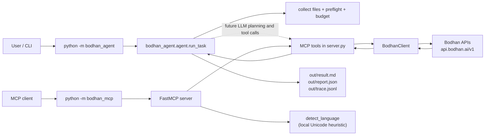

# Architecture

This document describes the implementation currently present in the repository.
The agent and MCP server are usable package entry points, but the agent is still
a deterministic preflight/reporting skeleton rather than a complete LLM tool loop.

## Folder tree

Generated caches, bytecode, virtual environments, and runtime output are omitted.

```text
.
├── src/
│   ├── bodhan_agent/
│   │   ├── __init__.py
│   │   ├── __main__.py
│   │   └── agent.py
│   └── bodhan_mcp/
│       ├── __init__.py
│       ├── __main__.py
│       ├── client.py
│       ├── languages.py
│       └── server.py
├── tests/
│   ├── test_agent.py
│   ├── test_bodhan_client.py
│   ├── test_languages.py
│   ├── test_project_skeleton.py
│   └── test_server.py
├── .env.example
├── Dockerfile
├── Makefile
├── README.md
└── pyproject.toml
```

`src/` is the configured setuptools package root. The importable package names
are therefore `bodhan_agent` and `bodhan_mcp`; the old `ai/` and `backend/`
source directories are no longer part of the current layout.

## Module responsibilities

### Agent

- `src/bodhan_agent/__init__.py` — marks the task-agent package.
- `src/bodhan_agent/__main__.py` — parses task, input, output, and budget CLI
  arguments, then calls `run_task`.
- `src/bodhan_agent/agent.py` — collects files, performs deterministic
  preflight and budget checks, writes `result.md`, `report.json`, and
  `trace.jsonl`, and refuses to fabricate model output.

### MCP and Bodhan client

- `src/bodhan_mcp/__init__.py` — marks the MCP package.
- `src/bodhan_mcp/__main__.py` — starts the MCP stdio entry point.
- `src/bodhan_mcp/server.py` — registers typed FastMCP tools for language
  detection, transcription, translation, speech synthesis, and OCR.
- `src/bodhan_mcp/languages.py` — owns language names and aliases, Unicode
  script detection, normalization, and capability checks.
- `src/bodhan_mcp/client.py` — validates files, selects per-model credentials,
  performs bounded async HTTP retries, limits concurrency, caches responses,
  returns structured errors, and calculates INR costs.

### Supporting files

- `tests/test_agent.py` — agent preflight, output, and CLI budget tests.
- `tests/test_bodhan_client.py` — client retry, cache, credential, and error
  tests.
- `tests/test_languages.py` — language normalization, capability, and script
  detection tests.
- `tests/test_server.py` — MCP registration, schema, normalization, and
  validation tests.
- `tests/test_project_skeleton.py` — package importability smoke test.
- `.env.example` — documents Bodhan model keys and optional LLM settings.
- `Dockerfile` — installs ffmpeg and Poppler, then installs the package.
- `Makefile` — runs Ruff and pytest through `make check`.
- `README.md` — setup and high-level usage documentation.
- `pyproject.toml` — package metadata, dependencies, and tool configuration.

## Data flow

The intended end-to-end relationship is shown below. The dotted edge is
deliberately not implemented yet: the current agent stops after preflight or
reports that integration is unavailable.



The currently implemented MCP path is:

```text
MCP client -> python -m bodhan_mcp -> server.py -> BodhanClient -> Bodhan APIs
```

The currently implemented agent path is:

```text
python -m bodhan_agent -> agent.py -> preflight/budget -> output files
```

It does not currently call `server.py`, `BodhanClient`, or an LLM.

## Entry points

- `pip install -e .` — installs the `src/` packages in editable mode.
- `python -m bodhan_mcp` — runs the FastMCP server over stdio.
- `python -m bodhan_agent --task "..." --files <path> --out <path>` —
  runs the bounded task-agent CLI.
- `make check` — runs `python -m ruff check .` followed by `python -m pytest`.

## Empty, duplicated, and unused items

### Empty files

No tracked source or documentation file is zero bytes. The two
`__init__.py` files are intentionally minimal package markers and contain
docstrings.

### Duplicated items

There are no exact duplicate tracked files. Language alias data is duplicated
across `src/bodhan_agent/agent.py` (`SUPPORTED_LANGUAGES`) and
`src/bodhan_mcp/languages.py` (`LANGUAGES`/`ALIASES`); the agent also has its
own `supported_language` helper. This is duplicated logic, not duplicate files,
and is a likely future consolidation target.

### Unused or not yet integrated items

- `src/bodhan_agent/agent.py:supported_language` is defined but has no callers.
- `LLM_BASE_URL`, `LLM_MODEL`, and `LLM_API_KEY` are documented in
  `.env.example` but no LLM bridge currently consumes them.
- The media-related dependencies in `pyproject.toml` are provisioned for
  planned media functionality; the current server does not yet expose media
  inspection, chunking, PDF rendering, or voice-listing tools.
