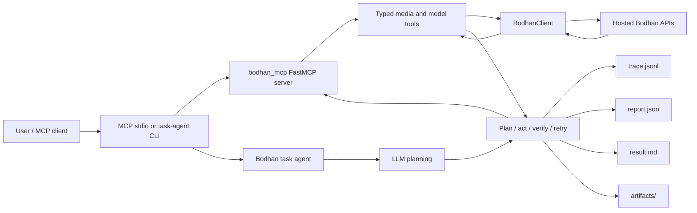

# Architecture

The MCP server owns Bodhan credentials and API transport, while the agent owns
planning, budgets, safety, verification, traceability, and output writing.
Media stays in local files and is passed by path.

The implementation exposes separate tools for transcription, translation,
speech synthesis, OCR, media inspection, PDF rendering, language detection,
voice listing, and language listing. This keeps model limits in code while
remaining directly usable by an MCP client.
